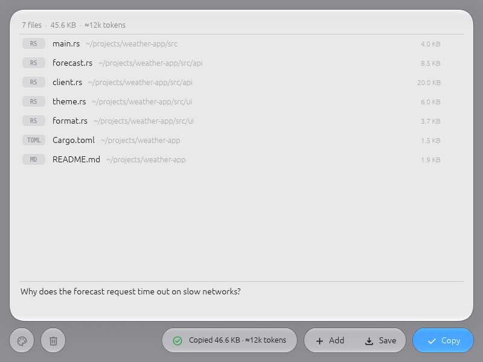
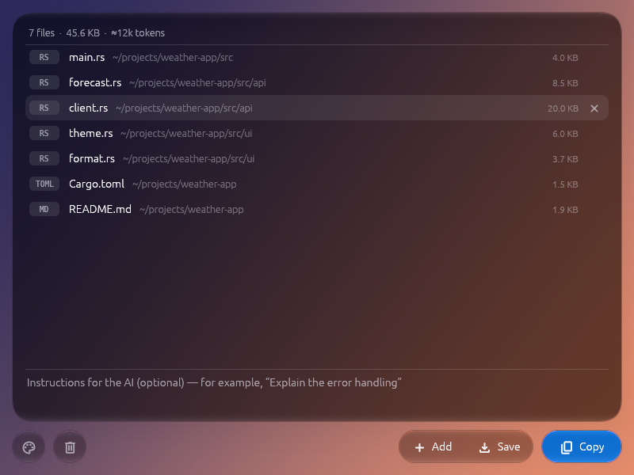

# File Aggregator

<p align="center">
  
</p>

Turn a handful of files into one clean Markdown prompt, from a calm Liquid Glass window or
the command line. Built with Rust: one binary, no runtime dependencies.

<p align="center">
  
  
</p>

## What It Does

File Aggregator takes files from your disk and combines them into a single Markdown
document: every file in its own fenced code block, labelled with its path, plus your
question or instructions at the top. Copy it to the clipboard or save it as a file. The most
common use is giving an AI assistant the context of several source files at once.

## Features

- **Two interfaces**: a window with drag and drop, and a full command line.
- **Calm Liquid Glass interface** rendered on the GPU with
  [liquid-rust](https://crates.io/crates/liquid-rust). The glass is there to carry context,
  not to decorate:
  - the files sit on one quiet frosted panel, with names in full contrast and folder, size and
    type dimmed;
  - **Copy** is the only tinted button;
  - feedback grows out of the toolbar as a glass toast ("Copied 74.5 KB · ≈19k tokens") and
    folds back into it;
  - the panel swells and turns blue while you drag files over the window;
  - scripts and executables are confirmed on one glass sheet per drop, not one dialog per file.
- **Your background**: grey by default, or any colour, a gradient or a photo. Your choice is
  remembered. The light or dark look follows the background automatically, or you can pick it.
- **Context at a glance**: file count, total size and an estimated token count.
- **Undo for Clear** instead of a confirmation dialog.
- **Fast**: parallel reads on a bounded thread pool. Each file is read exactly once, and the
  output buffer is allocated once. See [Performance](#performance).
- **Security controls**:
  - Path validation with canonical resolution (prevents traversal attacks)
  - Per-file size limit (50 MB), enforced while reading, so a file that grows after it was
    added can't slip past it
  - Total size limit (200 MB), checked before anything is read
  - Binary detection from magic bytes, not extensions
  - Warnings for executables, scripts and archives
  - Control characters and right-to-left override characters stripped from the output
  - Saved files are created readable by you only (`0600` on Unix)
- **Binary and non-UTF-8 files** are included as Base64.

## Quick Start

### GUI

```bash
file-aggregator                          # opens the window
file-aggregator gui src/main.rs README.md   # opens it with these files in the list
```

Drop files on the window (or click the empty panel), optionally type instructions, then
press **Copy** or **Save**.

| Shortcut | Action |
|---|---|
| `Ctrl`/`⌘` + `O` | Add files |
| `Ctrl`/`⌘` + `Enter` | Copy to clipboard |
| `Ctrl`/`⌘` + `S` | Save as Markdown |
| `Esc` | Close the background picker / skip the warning / dismiss the toast |

The palette button at the bottom left opens the background picker: colours, gradients, a
photo and Auto / Light / Dark.

### CLI

```bash
# Aggregate files and copy to clipboard
file-aggregator add file1.rs file2.toml file3.md

# Save to file instead
file-aggregator add --output result.md src/*.rs

# Interactive file picker (requires gum)
file-aggregator interactive
```

**`file-aggregator add <files...> [--output <path>]`**: aggregate the given files. Copies to
the clipboard unless `--output` is set.

**`file-aggregator interactive`**: pick files with [gum](https://github.com/charmbracelet/gum)
(space to select, enter to confirm), then choose clipboard or file.

**`file-aggregator gui [files...]`** or **`file-aggregator`**: open the window.

## Output Format

`````markdown
BEGINNING
Read following file and answer question given:
QUESTION

```rs path=/home/me/project/src/main.rs
fn main() {
    println!("Hello");
}
```

```toml path=/home/me/project/Cargo.toml
[package]
name = "example"
```

END
`````

- Your instructions replace the `QUESTION` line.
- A file that contains ` ``` ` itself (a README with code samples) gets a longer fence
  (` ```` `), so its own blocks can't end the fence early.
- Binary files, and text that isn't valid UTF-8, are included as a ` ```base64 ` block.
- Executables, scripts and archives start with a `# WARNING: Executable file content below`
  header.

## Build Instructions

### Prerequisites

- Rust **1.99** or later ([install via rustup](https://rustup.rs/)). liquid-rust requires it.
- A GPU driver with Vulkan, Metal, DirectX 12 or OpenGL. On Linux, Mesa works, including its
  software renderer.

### Build from Source

```bash
git clone --depth=1 https://github.com/al1h3n/file-aggregator.git
cd file-aggregator
cargo build --release
# Binary: target/release/file-aggregator
```

### Platform-Specific Builds

```bash
cargo build --release --target aarch64-apple-darwin      # macOS (Apple Silicon)
cargo build --release --target x86_64-apple-darwin       # macOS (Intel)
cargo build --release --target x86_64-unknown-linux-gnu  # Linux
cargo build --release --target x86_64-pc-windows-msvc    # Windows
```

### Building on Windows

**Prerequisites:**
- Visual Studio 2022 Build Tools with the "Desktop development with C++" workload
- Rust toolchain (rustup will auto-detect MSVC)

**Important:** make sure MSVC's `link.exe` comes before Git's Unix `link.exe` in `PATH`.
`where.exe link` should list `C:\Program Files\Microsoft Visual Studio\...` first. If you see
"link: missing operand", run the build from the "x64 Native Tools Command Prompt for VS 2022".

## Installation

Download a binary from [Releases](https://github.com/al1h3n/file-aggregator/releases):

| Platform | File |
|---|---|
| Windows | `file-aggregator-windows-x86_64.exe` |
| macOS (Apple Silicon) | `file-aggregator-macos-arm64` |
| macOS (Intel) | `file-aggregator-macos-x86_64` |
| Linux | `file-aggregator-linux-x86_64` or `file-aggregator-linux-x86_64.AppImage` |

```bash
# macOS / Linux: make it executable and put it on your PATH
chmod +x file-aggregator-*
sudo mv file-aggregator-linux-x86_64 /usr/local/bin/file-aggregator
```

## Performance

20 files × 10 MB (the 200 MB limit), same machine, back to back, output sanitized in both:

| | v0.1.0 | v0.2.0 |
|---|---|---|
| Code-like text | 603 ms | **223–244 ms** (~2.6× faster) |
| One repeated letter | 555 ms | **191–202 ms** (~2.8× faster) |
| Peak memory | 959 MB | **423 MB** |

4-vCPU Linux VM, files in the page cache. What changed and how to run it yourself:
[BENCHMARKS.md](BENCHMARKS.md).

```bash
cargo test --release --test benchmark -- --ignored --nocapture
cargo bench --bench file_aggregation   # criterion, 20 × 1 MB code files
```

## How the Window Is Built

- **egui 0.37** (eframe on wgpu) draws text and widgets. Icons are Material Symbols Rounded
  ([egui_material_icons](https://crates.io/crates/egui_material_icons)).
- **liquid-rust** draws the glass under them. A paint callback renders the background into a
  texture, which is redrawn only when the background or window size changes. liquid-rust then
  refracts that texture into a second one, but only when something moved. The callback copies
  the result into egui's frame, and egui draws the labels on top.
- The window repaints only on input or while something animates. An idle window uses no CPU.
- Copy and Save run on a worker thread, so even a 200 MB job never freezes the window.

| File | What's in it |
|---|---|
| `src/aggregator.rs` | Builds the Markdown document (parallel reads, fences, size limits) |
| `src/security.rs` | Path validation, single-read file loading, sanitizing, private file writes |
| `src/gui/mod.rs` | The window: layout, list, toolbar, toasts, picker, warning sheet |
| `src/gui/glass.rs` | Bridge between the app, liquid-rust and wgpu |
| `src/gui/background.rs` + `background.wgsl` | Colours, OKLab gradients, photo loading, the background shader |
| `src/gui/theme.rs` | Colours and egui styling for the light and dark schemes |
| `src/gui/format.rs` | Sizes, token estimates, path shortening |

## Security Warning

⚠️ **The output is plain text.** It contains your files' contents as they are. Before you
pipe it to a shell or run anything from it:

1. Review the aggregated content yourself
2. Check that no unexpected executables were included
3. Check Base64-encoded binaries for malicious content
4. Add scripts and executables only when you trust them

**Never** blindly run `file-aggregator add * | sh`. Always read the output first.

File Aggregator validates input paths and applies the controls above, but its output is
meant for **reading and review**, not for running.

## License

Licensed under the [MIT License](LICENSE).

## Contributing

Contributions are welcome! Please:
- Run `cargo fmt`
- Add tests for new security-sensitive features
- Update this README for user-facing changes

Run these before submitting (CI runs them on Linux, Windows and macOS):

```bash
cargo fmt --check
cargo clippy --all-targets -- -D warnings
cargo test
```
